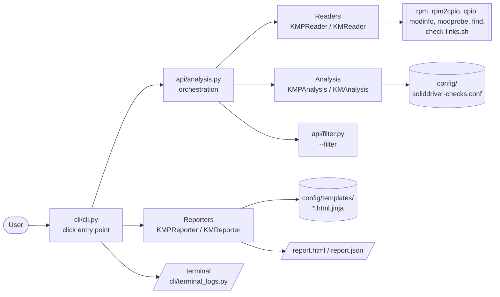
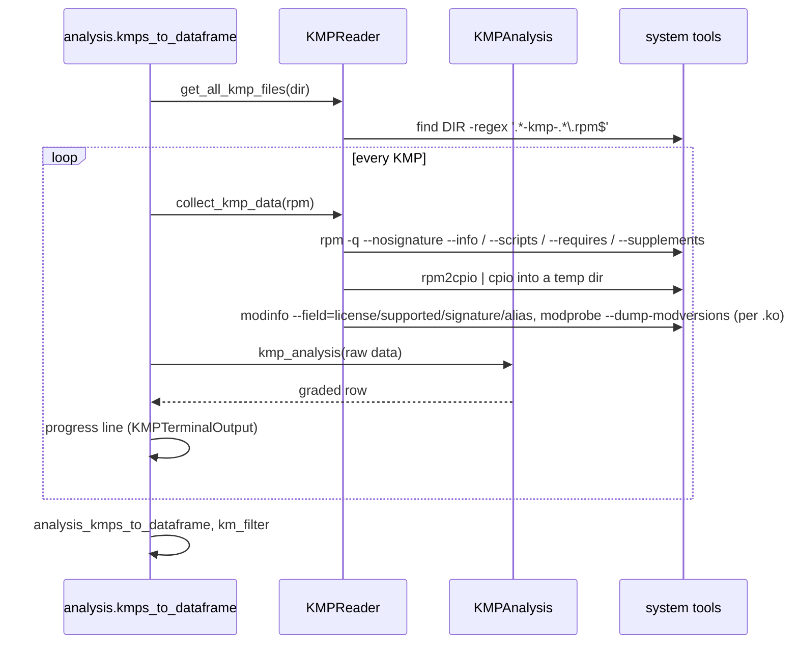
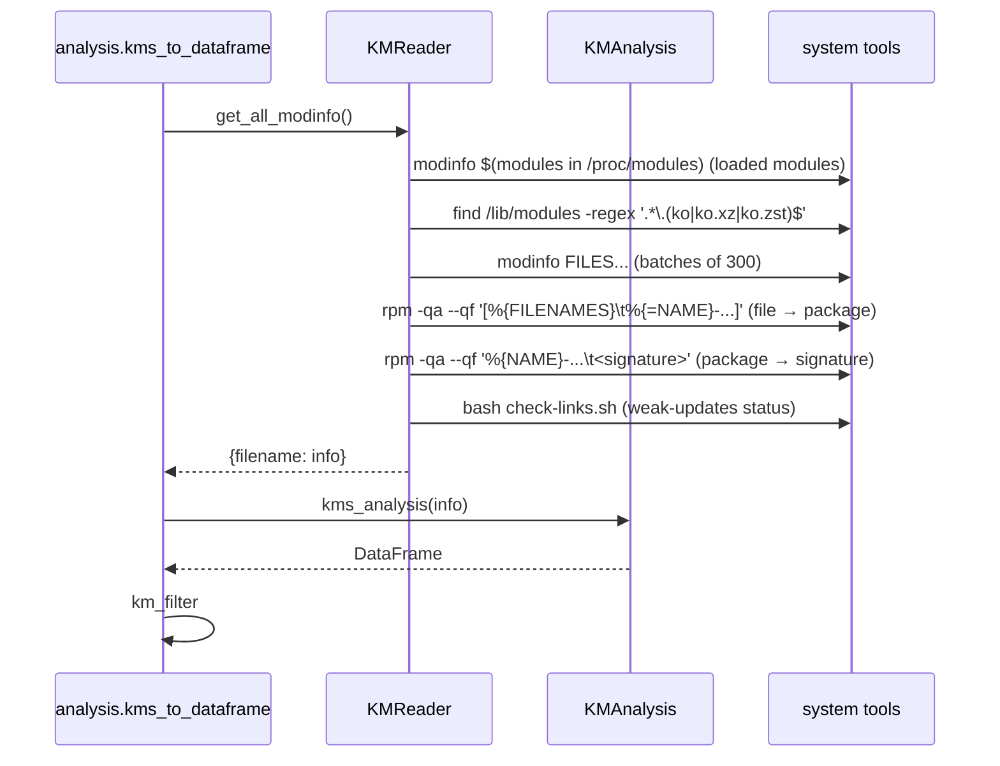

# Architecture

This document describes how `soliddriver-checks` is built: its components, how data flows through a check, the data model shared by all components, and the design decisions behind them. For usage, see the [README](../README.md). For how to develop, test and release, see [workflow.md](workflow.md).

## Purpose and scope

The tool checks that third-party kernel drivers are **built and packaged** the way SUSE requires (the SUSE SolidDriver Program). It has two subjects:

- **KMPs** (kernel module packages): `*-kmp-*.rpm` files that haven't been installed
- **KMs** (kernel modules): the modules installed or loaded on the system it runs on

It reads package metadata and module metadata only. It doesn't analyse module code, and it doesn't load or install anything. It never modifies the system, apart from writing the report file.

## Overview



The code is split into three layers, plus static configuration:

| Layer | Package | Responsibility |
| --- | --- | --- |
| Command line | `cli/` | Parse arguments, pick the check target, validate the filter, choose the output file, print progress, call a reporter |
| Checks | `api/` | Collect raw data with system tools (readers), grade it (analysis), build a pandas DataFrame, apply the filter |
| Configuration | `config.py`, `config/` | Accepted licenses, known signing keys, HTML colors, HTML templates |

The `api/` package has no presentation code, and `cli/` runs no system tools.

## Source layout

```text
src/soliddriver_checks/
  version.py                 __VERSION__, the single version source (setup.py parses it)
  config.py                  SDCConf: loads config/soliddriver-checks.conf; version/timestamp helpers
  config/
    soliddriver-checks.conf  JSON: valid-licenses, km.sig-keys, km.html colors
    templates/
      kmp-report.html.jinja  HTML page for KMP reports
      km-report.html.jinja   HTML page for kernel module reports
  api/
    analysis.py              public entry points: kmps_to_dataframe, kmp_analysis,
                             kms_to_dataframe, kms_to_json
    kmp.py                   KMPReader, KMPAnalysis, KMPEvaluation, KMP_COLUMNS
    km.py                    KMReader, KMAnalysis, KMEvaluation, KM_COLUMNS
    filter.py                filter grammar, evaluation, validation
    raw_data.py              legacy helpers, not used
    utils/cmd.py             run_cmd: subprocess wrapper (shell=True)
    utils/scripts/
      check-links.sh         checks weak-updates links, prints JSON
  cli/
    cli.py                   click command `soliddriver-checks`
    kmp_report.py            KMPReporter: to_html, to_json
    km_report.py             KMReporter:  to_html, to_json
    terminal_logs.py         per-KMP progress lines, single-KMP table
```

## Data model

All components share one data shape. Every **checked field** is a cell holding the field's content and its grade:

```json
{"value": "GPL", "level": {"level": "PASS", "value": 1}}
```

- `value` is the content shown in reports. It's usually a string; `running` and `wm2_invoked` are booleans.
- `level` is the grade. `KMPEvaluation` and `KMEvaluation` define it as `PASS = 1`, `WARNING = 2`, `ERROR = 3`; `to_json()` produces the `{"level", "value"}` form. Because the numbers are ordered, the worst grade is simply `max()`.

Each **row** (one KMP or one kernel module) also has a `level` column. It holds the row's overall grade, the worst grade of its fields, in the short form `{"level": "ERROR", "value": 3}`.

Rows are collected in a pandas DataFrame with fixed columns:

| Subject | Columns (`KMP_COLUMNS` / `KM_COLUMNS`) |
| --- | --- |
| KMP | `level`, `name`, `path`, `vendor`, `signature`, `license`, `wm2_invoked`, `supported_flag`, `km_signatures`, `km_licenses`, `symbols`, `modalias` |
| KM | `level`, `modulename`, `filename`, `license`, `signature`, `supported`, `running`, `kmp` |

These column names are used throughout:
- they're the keys in the JSON report
- they're the keys of the `--filter` language
- the reporters use them to build their tables

The column lists are defined once in `api/kmp.py` and `api/km.py`. An empty result still has these columns, so the filter and the reporters work without special cases.

What each field checks, and when it's a `WARNING` or an `ERROR`, is listed in the README section [What is checked](../README.md#what-is-checked).

## Check flows

`cli.run()` decides what to do with `Check_Target`:

| Target | Detected when | Flow |
| --- | --- | --- |
| Single KMP | the argument is an existing file ending in `.rpm` | `analysis.kmp_analysis()` → `single_kmp_output()` (terminal only) |
| Directory | the argument is an existing directory | `analysis.kmps_to_dataframe()` → `KMPReporter` |
| System | the argument is `system` (the default) and no file or directory has that name | `KMReporter`, which calls `analysis.kms_to_dataframe()` |
| Anything else | | usage error, exit code 2 |

Before scanning a directory or the system, the CLI:
1. validates `--filter` against the target's columns
2. works out the output file name (adding the extension)
3. asks before overwriting an existing file

Mistakes therefore fail immediately, not after a long scan.

### KMP check (directory or single file)



`KMPReader` gathers raw data per package:
- **RPM header:** name, vendor, signature, license.
- **Scriptlets:** checked for `weak-modules2`, either directly or through `/usr/lib/module-init-tools/kernel-scriptlets/`.
- **`ksym()` requirements:** symbol name and checksum.
- **`modalias()` supplements.**
- **Each module in the payload:** its license, supported flag, signature, PCI aliases and symbol versions.

The payload is extracted into a temporary directory, which is deleted afterwards. Modules can be `.ko`, `.ko.xz` or `.ko.zst`.

`KMPAnalysis` grades the package fields, then:
- grades each module
- summarises the module grades into one cell per check (`_kmp_km_ana_summary`): the worst grade, plus the distinct messages
- compares the modules' symbol versions with the package's `ksym()` requirements
- compares the modules' aliases with the package's `modalias()` supplements

RPM license tags are SPDX expressions. They're split on `AND`/`OR` (`WITH` exceptions are dropped), and each license is checked against `valid-licenses` in the config.

### Kernel module check (`system`)



The module list is the union of the loaded modules and every module file under `/lib/modules`. `KMReader` builds one dict entry per file, keyed by path:
- **`modinfo` output** is parsed block by block, starting at each `filename:` line. A file that `modinfo` can't read (for example a broken link) still gets an entry, so it's reported rather than lost.
- **Package ownership** comes from one query of the whole rpm database, not `rpm -qf` per file. Paths are compared after resolving directory symlinks (so `/lib/modules` matches `/usr/lib/modules` on usrmerged systems). A `weak-updates` link that isn't owned is credited to the package of its target.
- **Package signatures** come from a second database query. `(none)` means unsigned.
- **`weak-updates` status** comes from `check-links.sh`: `1` is a valid link, `2` a broken link, `3` a regular file where a link is expected.

## Filter

`--filter` is a small expression language. `api/filter.py` defines it as a [lark](https://github.com/lark-parser/lark) grammar (EBNF):

```text
expression  := disjunction | conjunction | operation
disjunction := conjunction ("or" conjunction)+
conjunction := group ("and" group)+
group       := "(" disjunction ")" | operation
operation   := "no" STRING | STRING "match" STRING | STRING "=" STRING | STRING "!=" STRING
```

`and` binds more tightly than `or` because of how the grammar is structured; no precedence table is needed.

The parse tree is evaluated by `KernelModuleListFilter`, a lark `Transformer`:
- Each condition becomes a boolean pandas Series over the rows.
- `conjunction` and `disjunction` combine the Series with `&` and `|`.
- `km_filter()` returns `data[mask]`.

Key resolution in `_cells()`:
- `key` refers to the cell's `value`.
- `key.level` refers to the cell's grade name.
- `level.level` refers to the row grade.

All values are compared as strings, so booleans match `"True"` and `"False"`.

`check_filter()` runs the same evaluation on an empty DataFrame with the target's columns. This finds syntax errors, unknown keys and invalid regular expressions without any data, and the CLI turns them into a usage error.

The same filter is applied in `analysis.kmps_to_dataframe()` and `analysis.kms_to_dataframe()`, so every output format sees the same rows.

## Reporting

| Output | KMP | Kernel modules |
| --- | --- | --- |
| HTML | `dominate` builds a per-vendor summary table and a detail table; Jinja renders them into `kmp-report.html.jinja` | pandas `Styler` renders the table, with cell colors from `km.html` in the config; Jinja renders it into `km-report.html.jinja` with totals and system information |
| JSON | `DataFrame.to_json(orient="records")`: one object per row, cells in the shape above | same |
| Terminal | single KMP: one line per check with a colored grade (`click.style`) | |

Templates are loaded relative to the package directory, so they work from a source tree and from an installed package. Progress and log messages go to stderr. During a directory scan nothing is written to stdout.

## Configuration

`config/soliddriver-checks.conf` is JSON, loaded by `SDCConf`:

| Key | Used by | Purpose |
| --- | --- | --- |
| `valid-licenses` | `KMPAnalysis`, `KMAnalysis` | Licenses accepted as open source, compared exactly (module `MODULE_LICENSE` strings and SPDX identifiers) |
| `km.sig-keys` | not used (`SDCConf.get_km_sig_keys()` has no callers) | Known SUSE signing keys |
| `km.html` | `KMReporter` | Warning and error cell colors in the HTML report |

The config, the templates and `check-links.sh` ship with the package through `MANIFEST.in` and `include_package_data`.

## Dependencies

**Runtime tools** (must be on the system): `rpm`, `rpm2cpio`, `cpio`, `find`, `bash`, and `kmod` (`/usr/sbin/modinfo`, `/usr/sbin/modprobe`). The tool therefore runs on SUSE Linux Enterprise and openSUSE, and checks can't run on macOS or Windows.

**Python packages** (`setup.py`):

| Package | Used for |
| --- | --- |
| `click` | Command line, prompts, colored terminal output |
| `pandas` | Row data, filtering, HTML table styling, JSON output |
| `lark` | Filter grammar |
| `Jinja2` | HTML page templates (also needed by pandas `Styler`) |
| `dominate` | HTML tables of the KMP report |

## Design decisions

- **System tools instead of libraries.** `rpm`, `modinfo` and friends are always present on the target systems and are the reference implementations, so their output is what SUSE tooling sees. The cost is parsing text output, and running on Linux only.
- **Shell commands are built as strings** and run with `shell=True` (`utils/cmd.py`), because several of them are pipelines. Every path is wrapped in `shlex.quote()`, since paths come from user input and may contain spaces.
- **Results are keyed by path or package name, never matched by position.** Matching the output of two commands line by line breaks as soon as one of them skips a file (broken links, errors), and credits modules to the wrong package.
- **Bulk queries.** File ownership and signatures come from one `rpm -qa` query each, and `modinfo` runs over batches of 300 files (`_split_cmd_args`). This avoids thousands of process starts and the argument length limit.
- **Grades are ordered integers**, so combining grades is always `max()`, at field, module-summary and row level.
- **One table shape everywhere.** Analysis, filter and reporters all work on the same DataFrame columns. Adding a check means adding a column and teaching each layer about it (see [workflow.md](workflow.md#adding-or-changing-a-check)).

## Known limitations

- **The rules are for third-party KMPs.** SUSE's own in-kernel KMPs (for example `ocfs2-kmp-default`) fail the `symbols` and `supported_flag` checks by design: they don't carry `ksym()` requirements and use `supported: yes`.
- **License expressions are checked conservatively.** In `GPL-2.0-only OR BSD-2-Clause`, every license must be accepted, even though `OR` means a choice.
- **The JSON kernel module report doesn't include the system information** that the HTML report shows (`TODO` in `KMReporter.to_json`).
- **Checks run sequentially**, with one `rpm2cpio` extraction per KMP, so large directories take a while.
- **A filter has no `not` operator.** `!=` and `no` cover the common cases.
- **`api/raw_data.py` is unused** legacy code.
